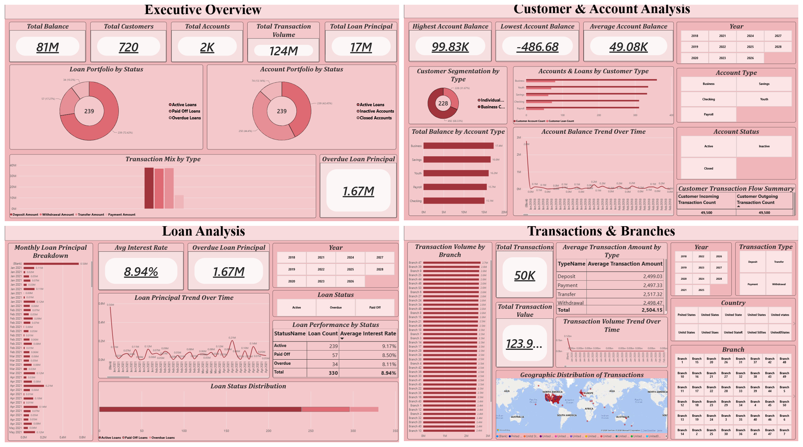
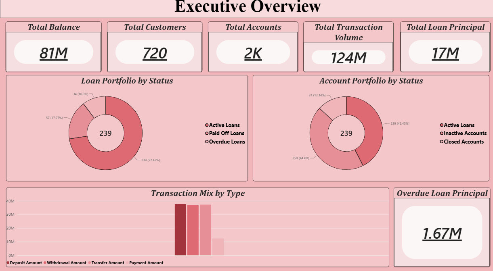
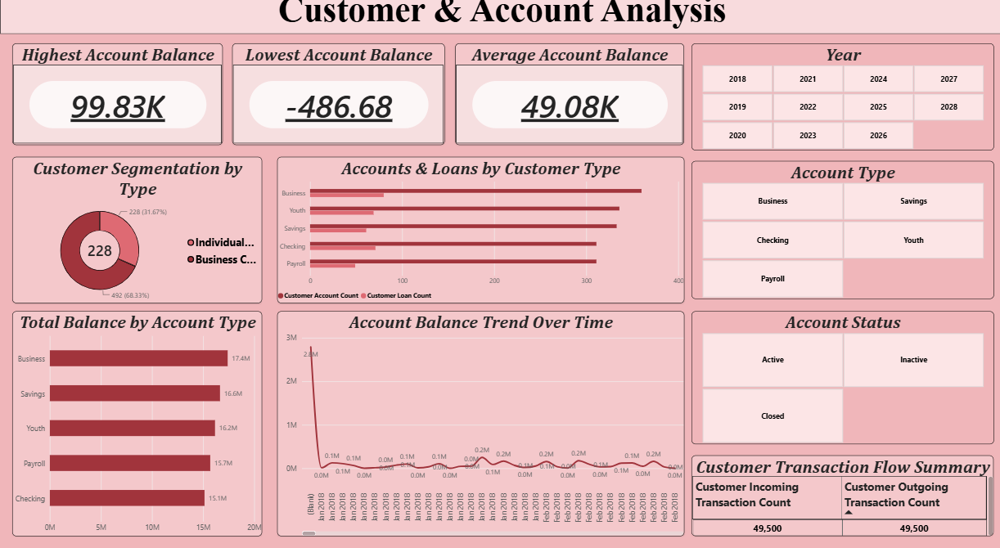
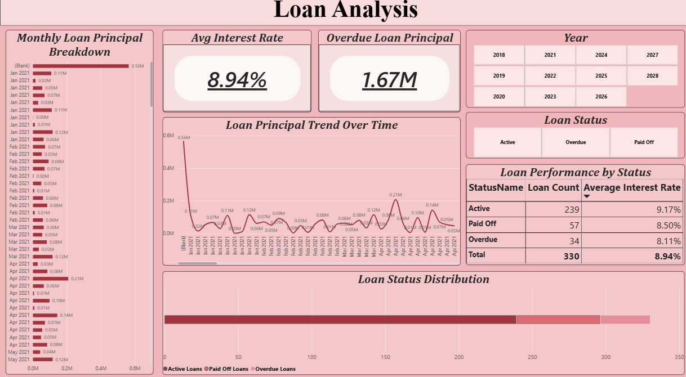
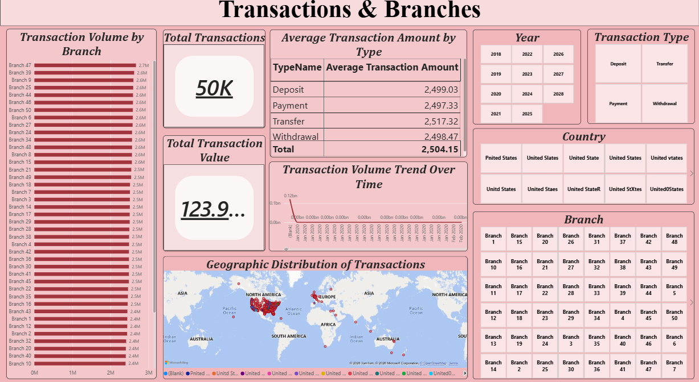

# Banking Operations Analytics Dashboard

> Interactive Power BI dashboard for analyzing banking operations, customer activity, accounts, loans, transactions, and branch performance.

---

## 📌 Overview

This project presents an interactive **Banking Operations Analytics Dashboard** developed using Microsoft Power BI.

The solution brings together customer, account, loan, transaction, and branch data into a unified analytical environment to help understand banking performance, customer behavior, loan portfolio health, transaction activity, and branch-level performance.

The project demonstrates the application of **data modeling, Power Query, DAX, KPI development, data visualization, and business analytics** to transform raw banking data into actionable insights.

---

## 📊 Key Metrics

| Metric | Value |
|---|---:|
| Total Balance | ₹8,10,36,977 |
| Total Customers | 720 |
| Total Accounts | 1,651 |
| Total Loan Principal | ₹1,70,87,413 |
| Total Loans | 330 |
| Total Transaction Value | ₹12,39,55,500 |
| Total Transactions | 49,500 |
| Total Branches | 50 |

### Customer Breakdown

| Customer Type | Customers |
|---|---:|
| Individual | 228 |
| Business | 492 |
| **Total** | **720** |

---

## 🗂️ Dataset Overview

| Entity | Records | Description |
|---|---:|---|
| Customers | 720 | Individual and business customers |
| Accounts | 1,651 | Bank accounts across multiple account types |
| Loans | 330 | Loan portfolio with status, principal and interest information |
| Transactions | 49,500 | Deposits, withdrawals, transfers and payments |
| Branches | 50 | Banking branches included in the analysis |

---

## 🎯 Business Objectives

The dashboard is designed to answer key business questions such as:

- How is the overall banking portfolio performing?
- How are customer balances distributed across account types?
- What is the current health of the loan portfolio?
- What proportion of loans are active, closed, or overdue?
- How are transaction volumes and values distributed?
- Which branches demonstrate higher transaction activity?
- How does customer type influence banking activity?
- Where are potential areas of operational or financial risk?

---

# 📈 Dashboard Preview



---

# 🖥️ Dashboard Pages

| Page | Focus |
|---|---|
| **1. Executive Overview** | Headline KPIs, account status, loan status, transaction mix and overdue risk |
| **2. Customer & Account Analysis** | Customer segmentation, account types, balance distribution and transaction flow |
| **3. Loan Analysis** | Loan performance, loan status, interest rates and principal trends |
| **4. Transactions & Branches** | Transaction trends, transaction mix, branch ranking and geographic distribution |

---

## 1️⃣ Executive Overview

The Executive Overview provides a consolidated view of the bank's overall performance.

### Key Areas

- Total balance
- Customer and account KPIs
- Loan portfolio status
- Transaction activity
- Overdue loan risk
- Account status distribution



---

## 2️⃣ Customer & Account Analysis

This page focuses on customer segmentation and account-level performance.

### Key Areas

- Individual vs. business customers
- Customer segmentation
- Account-type distribution
- Balance by account type
- Balance trends
- Transaction flow
- Customer activity



---

## 3️⃣ Loan Analysis

This page provides a detailed view of the bank's loan portfolio.

### Key Areas

- Loan status distribution
- Active vs. overdue loans
- Loan principal analysis
- Interest-rate distribution
- Loan trends
- Portfolio risk monitoring



---

## 4️⃣ Transactions & Branches

This page analyzes transaction behavior and branch-level performance.

### Key Areas

- Transaction type distribution
- Transaction value
- Transaction trends
- Branch performance ranking
- Geographic distribution
- Branch-level activity



---

# 🧩 Data Model

The dashboard uses a structured **star-schema-based Power BI data model** connecting the major banking entities.

### Core Data Entities

```text
Customers
     │
     ├── Accounts
     │
     ├── Loans
     │
     └── Transactions
              │
              └── Branches
